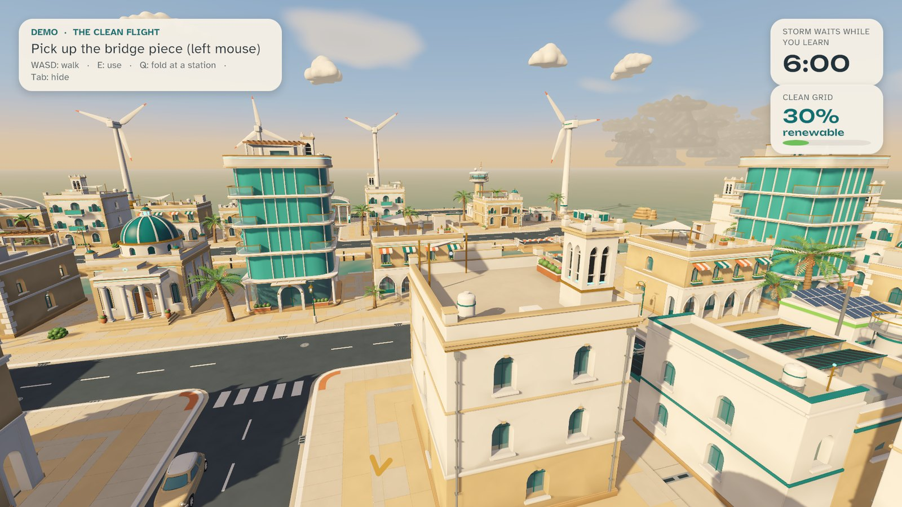

# SKYFOLD: The Clean Flight


<sub>Key art made with ChatGPT image generation (AI-generated). It is not an in-game screenshot; real game frames are below and in `docs/screenshots`.</sub>

By **Awaiz Ahmed and Huda Mueen / Team Kanban**: a single-player, nonviolent puzzle-adventure about the energy transition, for Windows. Play it on a laptop with keyboard and mouse, or in PC VR on Meta Quest 3 through Link. This is the **ADIPEC 2026 edition**, built around the theme *accelerating decarbonisation, energy security, resilience and industrial innovation*, for an audience of high school students and recent graduates.

> A storm has cut Nacre Bay's clean power link. Hold the city in your hands, rebuild the green corridor that carries wind and solar power to the island, deliver a green-hydrogen fuel cell to restart its microgrid, and send the city's first zero-emission flight into the sky before the storm arrives.



## Play

Install-free: unzip `SKYFOLD_v0.10.0_win64.zip` and double-click one of the `.cmd` launchers inside, or `SKYFOLD.exe`. On the build machine, `tools\package.ps1` also creates two Desktop shortcuts.

- **Laptop:** `SKYFOLD.exe --mode=desktop`, or the "SKYFOLD" shortcut.
- **Quest 3 through Link:** `SKYFOLD.exe --mode=vr`, or the "SKYFOLD - Quest 3" shortcut. See [docs/QUEST_LINK_SETUP.md](docs/QUEST_LINK_SETUP.md).
- **Three-minute demo:** `SKYFOLD.exe --demo` (asks laptop or VR first), or `--mode=desktop --demo` / `--mode=vr --demo` to go straight in.

Controls: [docs/CONTROLS.md](docs/CONTROLS.md). Presenting at a stand: [docs/PRESENTATION_SCRIPT.md](docs/PRESENTATION_SCRIPT.md).

## What's in it

- **Architect and Street.** Grab road and bridge modules on a 1:160 miniature city and snap them into sockets. Then fold down into the full-size city and drive across what you built. One city state drives both scales.
- **Three episodes and a demo.** *The Green Corridor* (rebuild the causeway that carries the island's power cable; the long west crossing or the east shortcut), *The Hydrogen Run* (drive a green-hydrogen fuel cell across your causeway and restart the airfield microgrid), *The Clean Flight* (repair the terminal link, switch on the solar runway beacons, let the electric shuttles arrive, clear the hydrogen-electric plane for take-off). The demo condenses the whole arc into three minutes.
- **Clean-grid meter.** The share of renewable power climbs from 30% to 100% as you repair the city. It is worked out from what you actually did, never from timers, and shows on the laptop HUD and the VR wrist panel. Each results screen adds a short, real energy fact.
- **An energy-transition city.** Onshore and offshore wind turbines with spinning rotors, solar farms, a solar carport with EV chargers, a grid-battery yard beside the airfield microgrid, a green-hydrogen works next to the depot, a direct-air carbon-capture unit on the harbour, and solar street lamps.
- **Storm timer.** It is the only way to fail. Retry from a checkpoint, and medals are computed from how you actually played.
- **Companions.** Noor, the city's energy engineer, guides you over the radio (local Kokoro TTS, subtitles on by default). NURI, a mechanical falcon, points the way.
- **Comfort.** Teleport or smooth movement, snap or smooth turning, vignette, seated mode, height and recenter. In VR, drive from the cockpit or remotely from a fixed overlook.
- **Detailed stylized art.** All 79 models are generated by Blender scripts: layered mouldings, deep windows with frames and shutters, twisted turbine blades with marked tips, PV panels with cell strips, feathered NURI, panel-lined vehicles with spoked wheels. A custom URP shader adds screen-space ambient occlusion, sky reflections on glass and metal, and subtle surface variation, with four shadow cascades.

## Build from source

Unity **6000.6.2f1** (URP 17.6, Input System, OpenXR 1.18, XR Interaction Toolkit 3.6). The scene, materials, input and XR settings are generated by editor code, so one command rebuilds everything:

```
powershell -NoProfile -ExecutionPolicy Bypass -File tools\build.ps1 -QA smoke demo -Package
```

Models: `blender -b --factory-startup -P tools/blender/build_env.py -- build all` (environment kit, including the `energy` group) plus the `tools/blender/veh_*.py` and `chars_*.py` scripts. Blender 5.2.

Automated QA scenarios: `tools\qa\run_qa.ps1 <scenario...>` (see [docs/QA_REPORT.md](docs/QA_REPORT.md)).

## Docs

[PLAN](docs/PLAN.md) · [ENVIRONMENT](docs/ENVIRONMENT.md) · [CONTROLS](docs/CONTROLS.md) · [QUEST_LINK_SETUP](docs/QUEST_LINK_SETUP.md) · [QA_REPORT](docs/QA_REPORT.md) · [ASSET_MANIFEST](docs/ASSET_MANIFEST.md) · [PRESENTATION_SCRIPT](docs/PRESENTATION_SCRIPT.md) · [ART_SPEC](docs/ART_SPEC.md)

## Credits and licences

All 3D models, music, ambience, icons and most sound effects are original, generated by scripts in `tools/`. Noor's voice is AI text-to-speech (Kokoro-82M, Apache-2.0, stock voice). The key art, Noor's radio portrait and the NURI reference sheet are AI-generated with ChatGPT image generation. Some effects layer CC0 Kenney.nl recordings. Fonts are Unbounded and Atkinson Hyperlegible (SIL OFL 1.1). Full details: [docs/ASSET_MANIFEST.md](docs/ASSET_MANIFEST.md). Noor and NURI are fictional characters, not depictions of any real person. Nacre Bay is fictional, and nothing here is endorsed by any government, company or event. The clean-grid percentages are game values, not real measurements.
