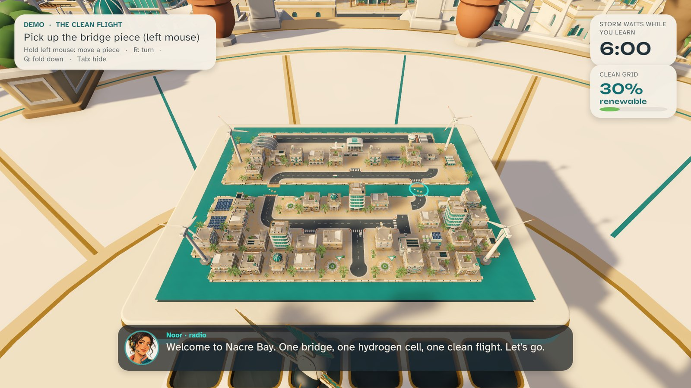

# SKYFOLD: The Last Flight


<sub>Key art made with ChatGPT image generation (AI-generated). It is not an in-game screenshot; real game frames are below and in `docs/screenshots`.</sub>

A hobby project by **Awaiz Ahmed / Team Kanban**: a single-player, nonviolent puzzle-adventure for Windows. Play it on a laptop with keyboard and mouse, or in PC VR on Meta Quest 3 through Link. It is **not** a SHIFT Game Jam entry (it was made before any theme reveal).

> Hold a broken coastal city in your hands, repair its roads as a giant, step inside the world you changed, and get the last flight away before the storm.



## Play

Install-free: unzip `SKYFOLD_v0.9.0_win64.zip` and double-click one of the `.cmd` launchers inside, or `SKYFOLD.exe`. On the build machine, `tools\package.ps1` also creates two Desktop shortcuts.

- **Laptop:** `SKYFOLD.exe --mode=desktop`, or the "SKYFOLD" shortcut.
- **Quest 3 through Link:** `SKYFOLD.exe --mode=vr`, or the "SKYFOLD - Quest 3" shortcut. See [docs/QUEST_LINK_SETUP.md](docs/QUEST_LINK_SETUP.md).
- **Three-minute demo:** `SKYFOLD.exe --demo` (asks laptop or VR first), or `--mode=desktop --demo` / `--mode=vr --demo` to go straight in.

Controls: [docs/CONTROLS.md](docs/CONTROLS.md).

## What's in it

- **Architect and Street.** Grab road and bridge modules on a 1:160 miniature city and snap them into sockets. Then fold down into the full-size city and drive across what you built. One city state drives both scales.
- **Three episodes and a demo.** *The Broken Causeway* (route choice: the long west crossing or the east shortcut), *The Courier Run* (carry a power cell across your causeway), *The Last Flight* (repair the terminal link, light the runway, let the convoy arrive, clear the departure). The demo condenses the whole arc into three minutes.
- **Storm timer.** It is the only way to fail. Retry from a checkpoint, and medals are computed from how you actually played.
- **Companions.** Noor guides you over the radio (local Kokoro TTS, subtitles on by default). NURI, a mechanical falcon, points the way.
- **Comfort.** Teleport or smooth movement, snap or smooth turning, vignette, seated mode, height and recenter. In VR, drive from the cockpit or remotely from a fixed overlook.
- **Detailed stylized art.** All 71 models are generated by Blender scripts: layered mouldings, deep windows with frames and shutters, balustrades, kerb stones and drains, feathered NURI, panel-lined vehicles with spoked wheels. A custom URP shader adds screen-space ambient occlusion, sky reflections on glass and metal, and subtle surface variation, with four shadow cascades.

## Build from source

Unity **6000.6.2f1** (URP 17.6, Input System, OpenXR 1.18, XR Interaction Toolkit 3.6). The scene, materials, input and XR settings are generated by editor code, so one command rebuilds everything:

```
powershell -NoProfile -ExecutionPolicy Bypass -File tools\build.ps1 -QA smoke demo -Package
```

Automated QA scenarios: `tools\qa\run_qa.ps1 <scenario...>` (see [docs/QA_REPORT.md](docs/QA_REPORT.md)).

## Docs

[PLAN](docs/PLAN.md) · [ENVIRONMENT](docs/ENVIRONMENT.md) · [CONTROLS](docs/CONTROLS.md) · [QUEST_LINK_SETUP](docs/QUEST_LINK_SETUP.md) · [QA_REPORT](docs/QA_REPORT.md) · [ASSET_MANIFEST](docs/ASSET_MANIFEST.md) · [PRESENTATION_SCRIPT](docs/PRESENTATION_SCRIPT.md) · [ART_SPEC](docs/ART_SPEC.md)

## Credits and licences

All 3D models, music, ambience, icons and most sound effects are original, generated by scripts in `tools/`. Noor's voice is AI text-to-speech (Kokoro-82M, Apache-2.0, stock voice). The key art, Noor's radio portrait and the NURI reference sheet are AI-generated with ChatGPT image generation. Some effects layer CC0 Kenney.nl recordings. Fonts are Unbounded and Atkinson Hyperlegible (SIL OFL 1.1). Full details: [docs/ASSET_MANIFEST.md](docs/ASSET_MANIFEST.md). Noor and NURI are fictional characters, not depictions of any real person.
